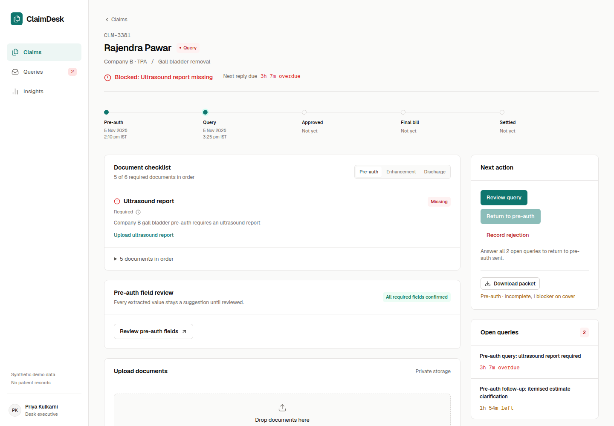

# ClaimDesk

A workspace for a hospital insurance desk. It keeps every cashless claim in one place, shows what each insurer needs before a file goes out, and times every TPA query. Built for the Isocode Labs Software Engineering Intern take-home.

**Live demo:** <https://isocode-claims.vercel.app>

| Role | Email | Password |
| --- | --- | --- |
| Desk executive | `desk@claimdesk.demo` | `ClaimDesk@2026` |
| Desk head | `head@claimdesk.demo` | `ClaimDesk@2026` |

The login page has a button for each account. The demo data resets every day at 03:00 IST. All patients and documents are fictional.



**Documents:** [Technical design](docs/technical-design.md) · [Deployment and local setup](docs/deployment.md) · [Security and residency notes](docs/design.md) · [Build spec](docs/SPEC.md)

## Try it in five minutes

1. Sign in as the **Desk executive**. On the worklist, click **Claims blocked by gaps**.
2. Open **CLM-3381**. The header says *Blocked: Ultrasound report missing*, and a TPA reply is about 3 hours overdue.
3. Upload [`seed/files/CLM-3381-ULTRASOUND_REPORT.pdf`](seed/files/CLM-3381-ULTRASOUND_REPORT.pdf). Rename it first if you like, because the AI reads the content, not the file name. Gemini places it in the Ultrasound slot as *needs confirmation*.
4. Click **Confirm**. The slot turns green and the claim is ready.
5. Open **Queries**. Read the AI summary above the original email, draft a reply, and click **Mark reply as sent** on both queries. The claim returns to *Pre-auth sent*.
6. Open **CLM-3385**. Its platelet report is older than the 24 hours Company D allows for dengue, so the slot shows *Stale*.
7. Sign in as the **Desk head** and open **Checklist rules**. Pick Company B, Gall bladder removal, Pre-auth. Each row shows which rule tier it comes from. Change a requirement and watch the affected claim's readiness change.

Try uploading [`seed/files/handwritten-notes.png`](seed/files/handwritten-notes.png), a photo of a handwritten note for Imran Shaikh, to Rajendra Pawar's claim. The system flags the patient mismatch and blocks submission.

## What is inside

- **Checklist engine** (`src/domain/checklist.ts`). For each payer, procedure and stage, the most specific rule wins: payer + procedure, then payer, then procedure, then the hospital default. Each slot is *missing*, *to verify*, *stale* or *satisfied*. Submission is refused on the server while any blocker remains.
- **Lifecycle** (`src/domain/claim-status.ts`). A transition table from pre-auth to settlement, with a checklist gate on each submission.
- **AI** (`src/ai/`). Gemini with a strict JSON schema, validated with zod. It classifies uploads into checklist slots, pre-fills pre-auth fields with source snippets, and summarises TPA queries. Nothing is accepted without a click, and nothing is sent to a TPA.
- **Security.** Roles are checked on the server. Every sensitive action is audited. Files sit in a private store and are served only through an authenticated route.

Stack: Next.js 16, React 19, TypeScript, Tailwind CSS v4, shadcn/ui, Drizzle ORM, Neon Postgres for records and private file bytes, Google Gemini, Vitest and Playwright. Hosted on Vercel, with functions in Mumbai. Uploads are limited to 4 MB per file; large photos are resized in the browser.

## Repository map

```
src/domain/     pure business rules: checklist, lifecycle, deadlines, identity, formatting
src/ai/         Gemini client and the fake client used in tests
src/server/     auth, audit, storage, uploads, packet builder, server-side queries
src/app/        routes: (workspace) screens, login, api/ (file stream, upload, packet, cron)
src/db/         Drizzle schema;  drizzle/  committed SQL migrations
seed/           fictional sample data and generated synthetic PDFs
tests/          Vitest unit and real-Postgres integration tests
e2e/            Playwright journeys against a production build
docs/           technical design, deployment, screenshots
```

## Run locally

You need Node.js 24, pnpm, a Postgres database and a Gemini API key. [docs/deployment.md](docs/deployment.md) lists every environment variable.

```sh
pnpm install --frozen-lockfile
pnpm db:migrate
pnpm db:seed
pnpm dev
```

To check the build, run:

```sh
pnpm lint && pnpm exec tsc --noEmit && pnpm test && pnpm test:e2e && pnpm build
pnpm ai:smoke    # real Gemini on a synthetic PDF and a handwritten PNG
```

## Boundaries

This deployment is for synthetic data only. The application and file storage run in Mumbai, but the database is in Singapore and Gemini processing may happen outside India. The project therefore does not yet meet the client's India-hosting requirement. [docs/design.md](docs/design.md) and section 8 of the technical design describe the production plan.
