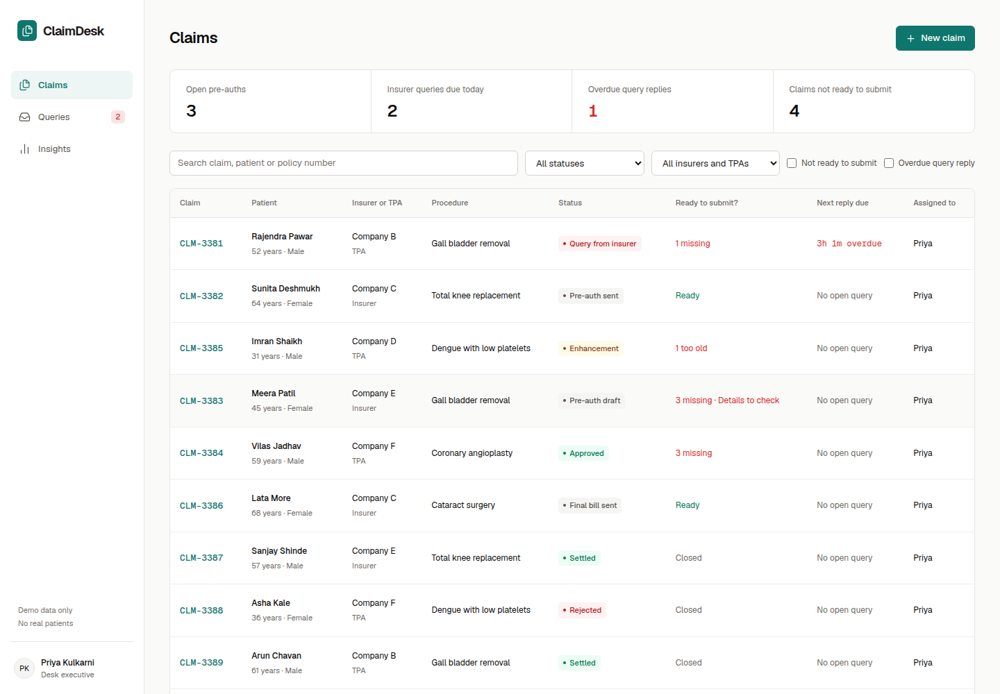
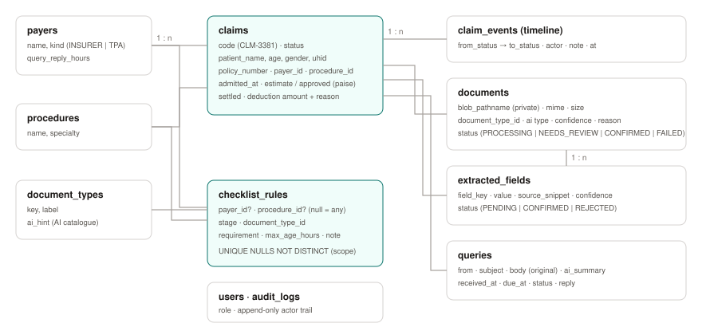
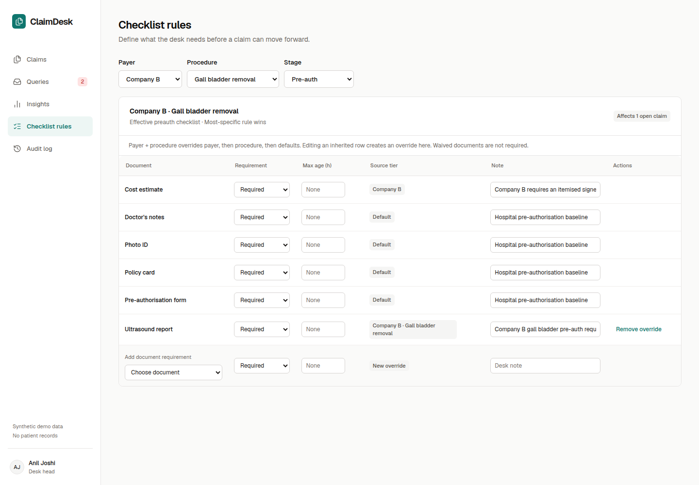
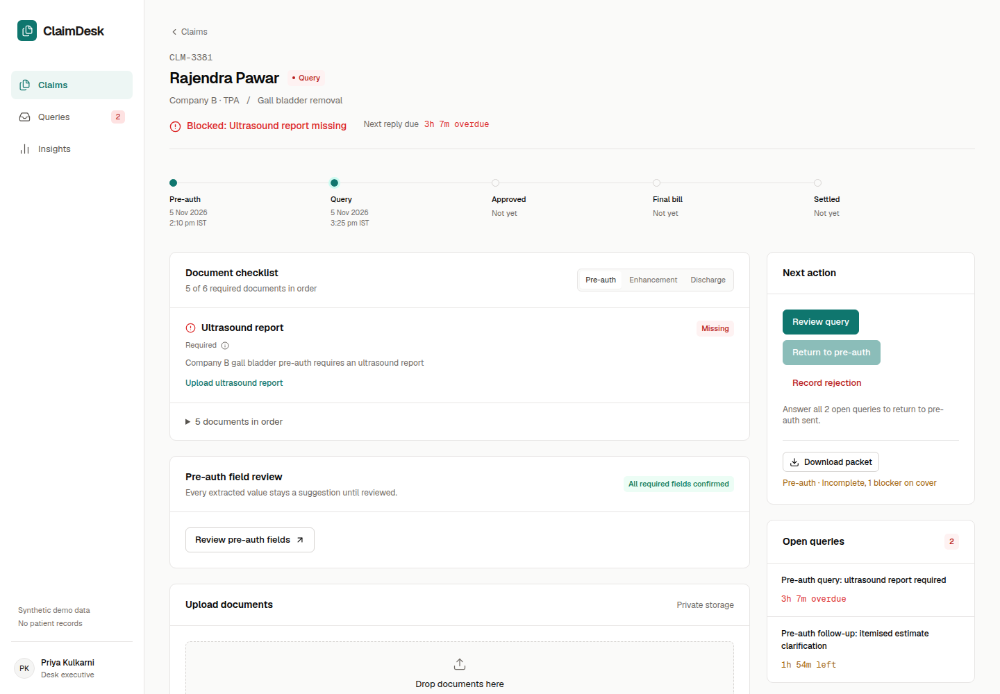
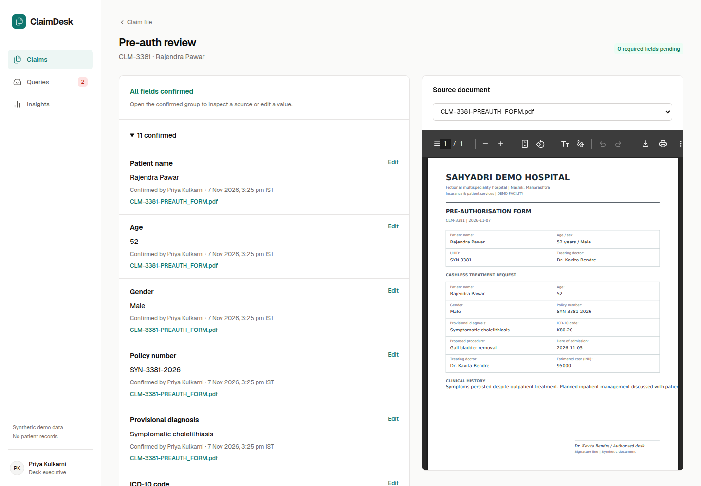
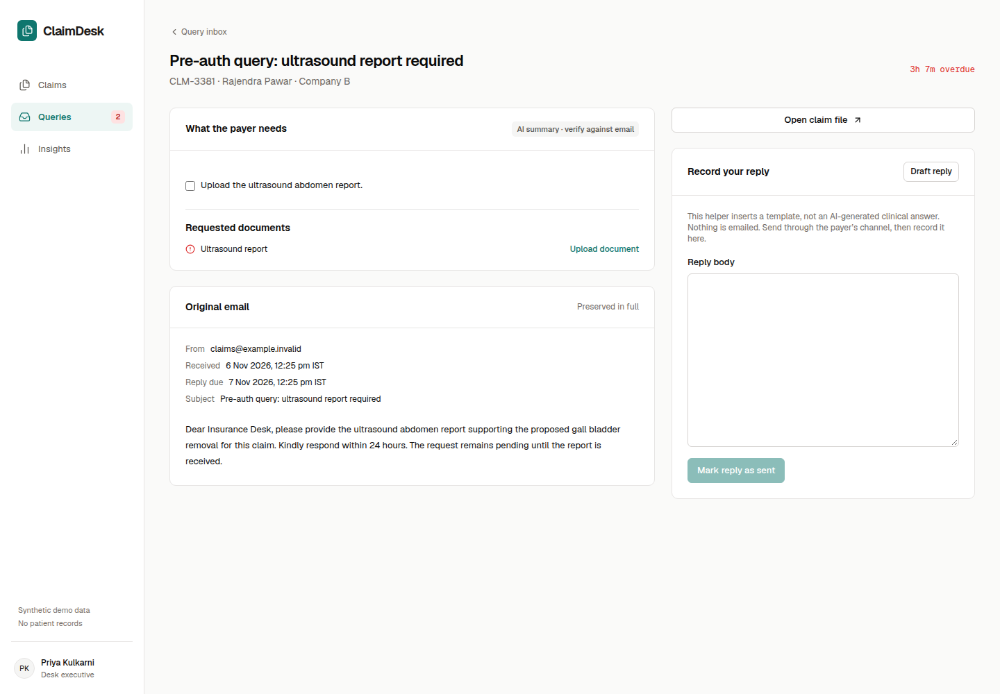
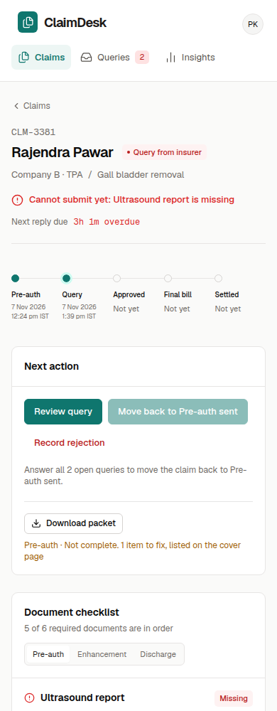
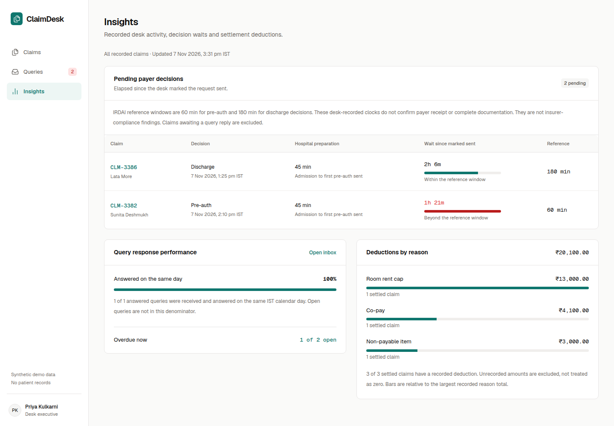

# ClaimDesk: Technical Design Document

**GitHub:** <https://github.com/heykay-47/claimdesk>

**Live demo:** <https://isocode-claims.vercel.app>

**Demo accounts:** `desk@claimdesk.demo` (desk executive) and `head@claimdesk.demo` (desk head). Password for both: `ClaimDesk@2026`. The login page has one-click buttons that fill them in.

Author: heykay-47 · Software Engineering Intern take-home for Isocode Labs · November 2026

Every patient, claim, document and email in this system is fictional. Each generated file carries the stamp “SYNTHETIC — FICTIONAL PATIENT”.

## 1. The problem in one paragraph

Company A's insurance desk loses about ₹53 lakh a year to deductions caused by missing documents, and about ₹10.5 lakh to the time spent answering TPA queries. In the client's words, “we lose money because a document was missing, not because treatment was wrong.” The desk works from email, Excel and WhatsApp. Nobody can see, before a file goes out, what a particular insurer needs for a particular procedure. Nobody can see when a query reply is due.

ClaimDesk puts every claim in one place. For each claim it computes what the insurer requires at the current stage, what is present, what is stale and what still needs a human check. It blocks submission until the gaps are closed, and it times every query reply. AI sorts uploads and pre-fills the pre-auth fields. A person confirms every AI suggestion, and nothing is ever sent to a TPA automatically.

## 2. What was built

The core build asked for 6 to 8 screens. ClaimDesk ships the core slice end to end, plus three optional MUST-HAVE items once the core was verified.

| Requirement | Status | Where |
| --- | --- | --- |
| Claim file with status timeline | Done | `/claims/[code]` |
| Admin checklist per insurer and procedure | Done (desk head only) | `/settings/checklists` |
| Uploads sorted into checklist slots by AI | Done, real Gemini | Claim file → Upload documents |
| Gap view | Done | Claim file → Document checklist |
| Query inbox with reply countdown | Done | `/queries`, `/queries/[id]` |
| Pre-auth field pre-fill with source snippet and one-click confirm | Done | `/claims/[code]/preauth` |
| Roles: desk executive and desk head | Done, enforced on the server | All routes and mutations |
| AI query summary with the original email below | Done (optional) | Query detail |
| Merged PDF packet per claim and stage | Done (optional) | Claim file → Download packet |
| Dashboard of pending approvals and deductions by reason | Done (optional) | `/insights` |
| Doctor approval of notes from a phone link | Not built (scope cut, see section 12) | — |

There are nine product screens: login, claims worklist, new claim, claim file, pre-auth review, query inbox, query detail with logging, checklist rules and audit log. Insights is a tenth, optional screen.



## 3. Architecture

```
Browser (desk executive / desk head)
  │  HTTPS, httpOnly session cookie
  ▼
Next.js 16 on Vercel, functions pinned to Mumbai (bom1)
  ├── Proxy: signature check, redirect to /login, early 403 for settings
  ├── Server components: read claims, run the checklist engine, render
  ├── Server actions + 3 route handlers: zod-validated, role-checked, audited
  │     ├── src/domain/*      pure rules: checklist, lifecycle, deadlines, identity
  │     ├── src/ai/*          Gemini client (structured output) + fake for tests
  │     └── src/server/*      auth, audit, storage, uploads, packet
  ├──▶ Neon Postgres (Singapore): claims, rules, documents, fields, queries, audit
  ├──▶ Vercel Blob, private store (Mumbai): document files, no public URLs
  └──▶ Google Gemini API: classify + extract, summarise queries
Vercel Cron (daily 03:00 IST) ──▶ /api/cron/reset-demo (bearer secret)
```

The stack is Next.js 16 (App Router, React 19, TypeScript strict), Tailwind CSS v4 with shadcn/ui, Drizzle ORM on Neon Postgres, private Vercel Blob storage, the Google Gen AI SDK, zod, jose and bcryptjs. Tests run on Vitest and Playwright.

### Why this shape

- **One deployable, no separate API service.** The desk has 9 people. A single Next.js app with server actions keeps the request path short and leaves one thing to deploy, monitor and explain. The three route handlers exist only where a plain HTTP endpoint is needed: file streaming, the upload handshake, and the cron reset.
- **Business rules are pure functions.** `src/domain/` has no database, network or framework imports. The checklist engine, the lifecycle table, the deadline rules and the identity check run the same way in the claim file, the worklist, the packet cover, the submission gate and the tests. The UI never re-implements a rule.
- **Drizzle instead of Prisma.** Drizzle has no generated client and no binary engine, runs on Neon's serverless driver, and keeps migrations as plain committed SQL (`drizzle/`). The schema needed `UNIQUE NULLS NOT DISTINCT` for the rule scopes, which Drizzle expresses directly.
- **Own session auth instead of an auth framework.** Two roles, a password login and an 8-hour session do not need OAuth flows. The session is an HS256 JWT holding only the user ID. Each protected operation reloads the user and role from Postgres, so a role change takes effect at once.
- **Direct-to-Blob uploads.** Vercel functions cap request bodies at 4.5 MB, and phone scans are often larger. The server issues a five-minute token scoped to one path, MIME type and exact size. The browser uploads straight to the private store. The server then verifies the object before it records anything.

## 4. Data model



| Table | Purpose | Notes |
| --- | --- | --- |
| `users` | Desk staff | `role`: EXECUTIVE or HEAD; bcrypt hash |
| `payers` | Insurers and TPAs | `kind`, `query_reply_hours` (default reply window) |
| `procedures` | Treatments | name, specialty |
| `document_types` | The catalogue AI classifies into | 15 types, each with an `ai_hint` |
| `checklist_rules` | The configurable rules | scope (`payer_id`, `procedure_id`, either may be null), `stage`, `requirement` (REQUIRED / OPTIONAL / WAIVED), `max_age_hours`; unique per scope with `NULLS NOT DISTINCT` |
| `claims` | One per admission | status, patient, policy, payer, procedure, money in paise, settlement and deduction |
| `claim_events` | Timeline | every status change, actor, note, time |
| `documents` | Uploaded files | private blob path, AI type, confidence, reason and answering model, review status, document date |
| `extracted_fields` | Pre-auth field proposals | value, source snippet, confidence, PENDING / CONFIRMED / REJECTED, reviewer |
| `queries` | TPA queries | original email, AI summary (JSON), `due_at`, reply, who answered and when |
| `audit_logs` | Append-only trail | actor, action, entity, detail, IP |

Money is stored as integer paise and shown with `en-IN` formatting. Times are stored in UTC and shown in IST.

## 5. The hard part: checklist rules per insurer and procedure

The problem statement names this as the hard part. The engine is in `src/domain/checklist.ts`, and it does two jobs.

**Rule resolution.** For a claim's payer, procedure and stage, each document type gets exactly one effective rule: the most specific one that exists.

1. Payer + procedure (for example, Company B · Gall bladder removal)
2. Payer only (Company B · any procedure)
3. Procedure only (any payer · Gall bladder removal)
4. Hospital default (any payer · any procedure)

The winning rule applies in full. If Company B waives a document that the hospital requires by default, the document disappears from Company B's checklist. A specific rule never inherits another tier's maximum age. Each resolved rule carries its source tier, so the UI can say *why* a document is required: “Company B gall bladder pre-auth requires an ultrasound report”.

I chose “most specific wins” over merging or summing rules because the desk head has to be able to predict the result. A rule screen that shows the effective list, with each row labelled by tier, can then show exactly what an insurer will see. Merging rules would hide that.

**Evaluation.** Given the resolved rules, the claim's documents and the reviewed pre-auth fields, the engine returns one slot per non-waived rule. Each slot is in exactly one state, modelled as a discriminated union:

| State | Meaning | Blocks submission? |
| --- | --- | --- |
| `MISSING` | No document of this type | Yes, if required |
| `UNVERIFIED` | A document is here, but only AI has sorted it | Yes, if required |
| `STALE` | Confirmed, but older than the rule's `max_age_hours` | Yes, if required |
| `SATISFIED` | Confirmed and fresh | No |

The engine also returns unsorted uploads (failed AI, OTHER, low confidence) and documents whose patient does not match the claim. Both block submission. At the pre-auth stage, every required pre-auth field must be confirmed. The result is a list of human-readable blockers and a single `ready` flag.

**The gate.** The lifecycle is a transition table in `src/domain/claim-status.ts`. Each row has `from`, `action`, `to` and an optional gate. The gates are the PREAUTH, ENHANCEMENT and DISCHARGE checklists, plus all queries answered. The server action that changes status loads the documents, rules and fields inside a transaction that locks the claim row, re-runs the engine and refuses the change when blockers remain. The client never supplies a status. On screen, a blocked primary button lists the blockers next to it.

The three sample claims exercise the engine directly:

- **CLM-3381**, Company B (TPA), gall bladder removal. A Company B + procedure rule requires an ultrasound report, and it is missing. An open query asks for it and is overdue.
- **CLM-3382**, Company C (insurer), total knee replacement. Every required document is confirmed and the claim is ready.
- **CLM-3385**, Company D (TPA), dengue with low platelets, at enhancement. A Company D + dengue rule requires a platelet count no older than 24 hours. The platelet report on file is older, so the slot is `STALE`.



When the head changes a rule, the screen first shows how many open claims it affects. Waiving a required document asks for confirmation, and every change is audited. Because readiness is computed on every read, never stored, a rule change shows on every affected claim immediately. There is no migration and no stale cache.

## 6. Primary workflows

**Close a gap and answer a query (desk executive).**

1. The worklist opens with four counters: open pre-auths, queries due today, overdue queries and claims blocked by gaps. Each counter is a filter.
2. CLM-3381 shows “Blocked: Ultrasound report missing” and “Next reply due · 3h overdue” above the timeline.
3. The executive drops a scan onto the upload zone. Gemini identifies an ultrasound report and places it in the Ultrasound slot as “AI-sorted · 100% · needs confirmation”, with the model's reason one click away.
4. One click on **Confirm** turns the slot green and the readiness sentence changes.
5. In the query inbox, the AI summary lists what the TPA asked for and maps each requested document to the claim's slots. The original email is always shown below the summary. The executive drafts a reply from a template, sends it through the TPA's own channel, and clicks **Mark reply as sent**. When the last open query is answered, the claim returns to Pre-auth sent.



**Review pre-filled fields.** Each proposed field shows its value, the exact source snippet, the source document and the AI's confidence. Pending and conflicting fields come first, and confirmed fields collapse into one line. When two documents disagree (say, the age on the ID card and on the form), both values appear and the reviewer picks one. Clicking a source opens that document in the preview beside the field.



**Configure rules (desk head).** Pick a payer, procedure and stage. Read the effective checklist with each row's tier. Change a requirement inline, add a document type or remove an override.

**Download a packet.** The claim file builds one PDF for the current stage: a cover sheet with the checklist states, the confirmed pre-auth fields, any blockers and who prepared it, followed by every confirmed document in checklist order. An incomplete packet can still be downloaded, but the button warns and the cover lists the blockers first. Nothing is sent.

## 7. AI implementation

The client is `src/ai/gemini.ts` behind a two-method interface (`classifyAndExtract`, `summariseQuery`). Tests and the end-to-end suite use `src/ai/fake.ts` instead.

- **Model:** `gemini-3.5-flash`, with `gemini-2.5-flash` and then `gemini-3.8-flash` as fallbacks. PDFs and images (JPEG, PNG, WebP up to 10 MB) are sent inline. Gemini reads both natively, which matters because doctors' notes are often handwritten phone photos.
- **Structured output:** every call sets a JSON `responseSchema`, and the result is validated again with zod. A schema violation is a failure and is never retried with a looser prompt.
- **Prompt safety:** the system instruction treats document and email content as untrusted data, never as instructions. The classifier may only choose from the document-type catalogue, and the extractor may only fill fields from the pre-auth field registry, each with a verbatim source snippet.
- **Nothing is auto-accepted.** A successful classification lands as `NEEDS_REVIEW`, and every extracted field lands as `PENDING`. Confidence below 0.75, or a type outside the catalogue, adds an “AI unsure” marker and sends the file to the unsorted tray. A misfiled document can be dragged to the right slot, or moved with a keyboard-accessible **Move to…** menu.
- **Failure is visible and recoverable.** On an error, timeout or invalid output, the file is saved, marked `FAILED` with a plain message, and placed in the unsorted tray with **Retry AI** and manual sorting. A failed query summary leaves the original email on screen with a retry button. A failure never fills a slot.
- **Fallback and back-off.** Only transient failures (429, 503, 504, unavailable, timeout) move on to the next model, inside an overall 45-second budget. A model that fails this way is skipped for five minutes. This fix came from production testing: when the primary model's free quota ran out, each upload spent about 28 seconds waiting on a congested fallback. Afterwards, uploads took 8 to 9 seconds. The answering model is recorded in each document's AI reason.
- **Patient identity check.** After extraction, a deterministic check compares the patient name (and policy number or UHID, when present) on the document with the claim. Honorifics, order and initials are ignored, so “Pawar Rajendra S.” matches “Rajendra Pawar”. A clear mismatch blocks the slot and the submission until someone removes the file or confirms it is the same patient. This was added after a production test in which a handwritten note for Imran Shaikh, uploaded to Rajendra Pawar's claim, was sorted without any warning.

**Measured on production (7 November 2026):** an ultrasound PDF renamed `scan_0042.pdf`, so the filename gives no hint, was classified as `ULTRASOUND_REPORT` with confidence 1.0. A PNG photo of a handwritten admission note was classified as `DOCTOR_NOTES` with confidence 0.95, and its patient name, age, diagnosis, proposed treatment and doctor were extracted with verbatim snippets. Both stayed in `NEEDS_REVIEW` until a person confirmed them.

**Limitations.** These results come from synthetic documents generated for the demo. Real scans will be noisier, and accuracy has not been measured on a labelled set of real documents. The confidence score is the model's self-report, not a calibrated probability. The 0.75 threshold is a starting point to tune with the desk. The free Gemini tier has daily quotas. Production would need a paid tier or a regional deployment of the model (see section 8).

## 8. Security and privacy

Patient records are sensitive personal data under the DPDP Act 2023. The demo implements these controls:

- **Role-based access on the server.** Every server action and route handler calls `requireUser()` or `requireRole("HEAD")`. Hiding a button is cosmetic only. The settings pages return a real HTTP 403 to an executive, and the rule-changing actions reject them independently. Both are tested.
- **Audit log.** Append-only rows record sign-in, failed sign-in, sign-out, claim creation, each status change, upload, each document view or download, field confirmation and edit, rule change, query logging and reply, packet download and demo reset. The head can filter the log at `/settings/audit`.
- **Private files.** Files live in a private Blob store. The browser never receives a public URL or a store credential. Every preview and download goes through `/api/documents/[id]/file`, which checks the session, writes an audit row and responds with `Cache-Control: private, no-store`.
- **Sessions.** The cookie is httpOnly, `SameSite=Lax`, `Secure` in production, and expires after 8 hours. The upload endpoint also checks the `Origin` header. Failed sign-ins are rate-limited per account and per IP. Successful sign-ins never count, because reviewers share the demo accounts and often an office IP. That bug was found and fixed during production testing.
- **Validation everywhere.** zod parses form input, API input, AI output and the session subject.
- **Headers.** HSTS, `X-Content-Type-Options`, `X-Frame-Options: SAMEORIGIN`, `Referrer-Policy: no-referrer` and a restrictive `Permissions-Policy` are set.
- **Secrets.** Secrets live only in environment variables (Vercel sensitive variables) and are never committed. The repository history was scanned before it was made public.

**Hosting in India: what is and is not true.** The application functions and the document store run in Mumbai (Vercel `bom1`). The database runs in Singapore, because Neon has no India region, and Gemini processing may happen outside India. **This deployment therefore does not meet the India-hosting constraint, and it is approved only for synthetic data.** Before accepting real records, the production plan is:

1. Move Postgres to an India region (AWS RDS or Aurora in `ap-south-1`, or Supabase in Mumbai).
2. Run the model under an India-region processing agreement (Gemini on Vertex AI in `asia-south1`, or an equivalent), or turn AI off. Manual sorting and entry still work, so the product does not depend on AI.
3. Complete the hospital's DPDP review: a processor agreement, retention and deletion periods, consent records, access reviews and a breach-response process.
4. Grant the application database role insert-only rights on `audit_logs`, and move the login rate limit to a shared store.

## 9. UI and UX decisions

The client said design counts as much as features, and the claim file must show at a glance what is missing and what is overdue.

- **The claim file answers three questions before any scrolling:** what blocks this claim (a single sentence in red), when the next reply is due (a live countdown) and what to do next (the primary action with its blockers). The timeline follows. In the gap view, missing, stale and unverified slots come first, and satisfied documents collapse to one line: “5 documents in order”.
- **Colour carries meaning, never decoration.** The surfaces are warm stone with 1 px borders. Deep teal marks actions and focus. Red means missing or overdue, amber means due soon, stale or needs confirmation, and green is a small mark for ready. There are no gradients, illustrations or emoji.
- **Type:** Geist Sans for text. Geist Mono with tabular figures for claim IDs, money and countdowns, so numbers line up and do not jitter as they tick.
- **Every rule explains itself.** Each checklist slot can show which tier required it and why.
- **AI output always sits next to its evidence:** the snippet beside the value, the original email under the summary and the model's reason under the suggestion.
- **No dead ends.** Every list has a loading skeleton, an empty state and an error boundary with a retry. Destructive or consequential actions (submissions, waivers, marking a reply as sent, removing a document, demo reset) ask for confirmation. Every result produces a toast.
- **Accessibility:** labelled controls, visible focus, a skip link, a keyboard alternative to drag-and-drop, `role="timer"` on countdowns and contrast at or above 4.5:1. Automated WCAG A/AA scans of the claim file, rules and insights screens found zero violations.
- **Mobile:** on a phone the claim file puts the next action before the long content, and the navigation becomes a top bar.

| Query detail: AI summary, requested documents and the original email | Claim file on a phone |
| --- | --- |
|  |  |



The IRDAI windows (1 hour for cashless decisions, 3 hours for discharge) are shown as reference lines. The timers measure the hospital's own recorded times, from admission to pre-auth sent and from query received to reply sent. They do not claim insurer compliance, because the system cannot see when the insurer actually received a file.

## 10. Testing

| Layer | Tool | Count | What it proves |
| --- | --- | --- | --- |
| Domain unit | Vitest | {{UNIT}} | Every precedence tier, waivers, freshness boundaries, every slot state, unsorted and mismatch blockers, required fields, illegal transitions, gates, deadline states at their boundaries, patient-name matching |
| AI client | Vitest with a stubbed SDK | 9 | Fallback on 429/503/504/timeout, no retry on 400/401 or invalid output, model back-off, Gemini 2.5 thinking budget |
| Integration | Vitest, real Postgres | {{INTEGRATION}} | Role enforcement in server functions, the three sample claims' checklists, submission gate refusal, uploads with the fake AI, AI failure to unsorted, move and confirm, query logging and deadlines, last reply returns the claim to pre-auth, executive blocked from rule changes, packet contents |
| End to end | Playwright, production build | {{E2E}} | The journeys in section 6 for both roles, run against `pnpm build && pnpm start` |
| Production smoke | Real Gemini, live deployment | manual | Section 7 measurements, cron authorisation (401 without the secret, 200 with it), login and upload on the live site |

Integration tests run inside a unique Postgres schema within a transaction that is rolled back, so they never change the demo data. The end-to-end suite uses the fake AI client for determinism. It removes only the claims and files it created, then reseeds.

Last run: {{TEST_SUMMARY}}

## 11. Assumptions

These are explicitly mine, not the client's:

- “Submit” means the desk sends the file through the insurer's own portal or email, which is out of scope, and then records the submission in ClaimDesk. The same applies to replies.
- Incoming TPA emails are logged by pasting them into **Log incoming query**. This mocks a shared mailbox integration.
- A query's due time is the deadline stated in the email, when the AI finds an unambiguous one. Otherwise it is the payer's configured reply window (24 hours by default). “Due soon” means 4 hours or less.
- Enhancement and discharge have their own checklists. The sample data's “Enhancement” status maps to the ENHANCEMENT stage.
- A report with only a date counts from IST midnight for freshness checks. This is the conservative reading.
- One deduction reason is captured per settlement, from a fixed list: missing document, non-payable item, room-rent cap, co-pay, or other.
- The desk head is the “admin” in the problem statement. There is no separate administrator role.
- The demo resets daily at 03:00 IST, so reviewers always find the same story with current timestamps.

## 12. Scope cuts and future work

Cut on purpose, in order of what I would build next:

1. **Doctor approval from a phone link.** This needs a third, unauthenticated-by-password actor and a signed, single-use link flow, which deserves its own security review. With the time available, the core slice came first.
2. **A real mailbox integration** (IMAP or Gmail API) to replace pasted queries. The summariser and deadline logic are already in place.
3. **India-resident production hosting** (section 8).
4. **AI evaluation on a labelled set** of anonymised real documents, to tune the 0.75 threshold per document type.
5. **Background processing** for large batches. AI currently runs within the upload request, inside a 60-second limit. That is fine for the desk's one-file-at-a-time pattern, but not for bulk import.
6. **Operational hardening:** a shared rate-limit store, insert-only audit privileges, cleanup of orphaned uploads, and a non-Latin font for packet cover sheets.
7. **Notifications** for queries that become due soon, by email or WhatsApp. The problem statement mentions WhatsApp chasing.

## 13. How this was built

I used AI coding tools heavily. Claude Opus acted as lead and reviewer, and GPT-based coding agents implemented each phase from a written specification (`docs/SPEC.md`). Every phase was reviewed against its diff, its screenshots and its test output before it was accepted. Production testing, not the agents' reports, found the five most important fixes:

- Models were running out of quota, so I added fallbacks and back-off.
- Successful sign-ins were triggering the rate limit.
- Upload replies could be lost on a dropped connection, so the page now refreshes after an error.
- The demo data used fixed timestamps, which would have made everything look overdue on review day.
- Documents for the wrong patient were accepted without warning.

The commit history in the repository records each of these steps.
